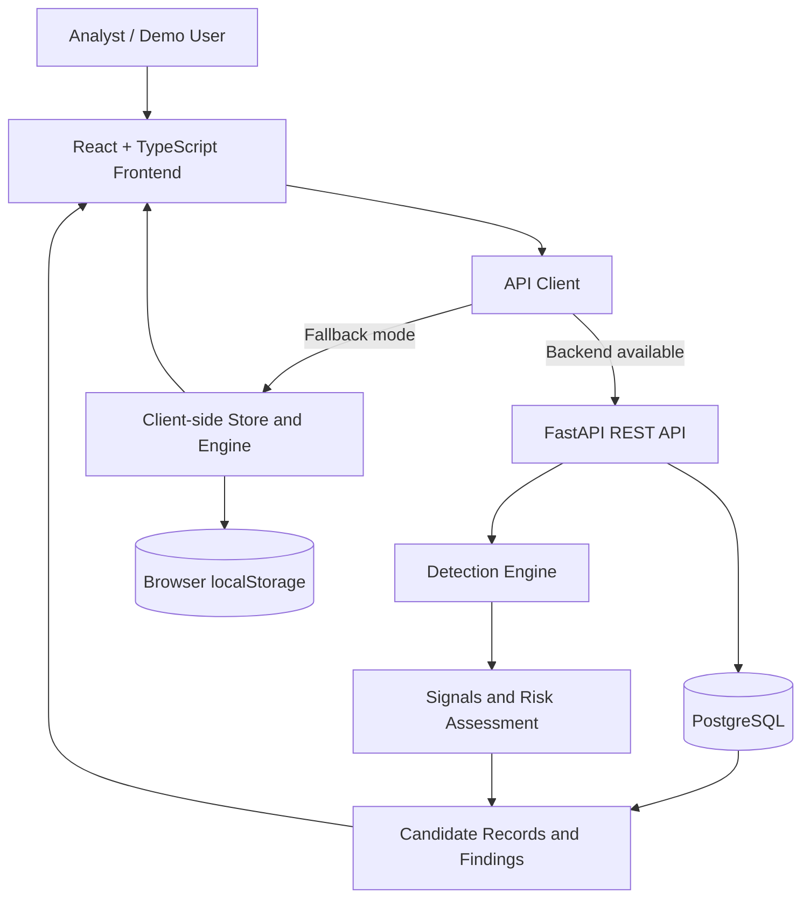

# BrandGuard — Digital Identity Protection Platform

> Deterministic, explainable triage for suspicious brand social profiles and mobile applications.

**Live Demo:** [Open BrandGuard](https://brand-guard1.vercel.app)  
**GitHub Repository:** [Dilshad-shaik-14/BrandGuard1](https://github.com/Dilshad-shaik-14/BrandGuard1)  
**Project Type:** Hackathon prototype and security investigation demonstration

BrandGuard is a React and FastAPI application for registering a brand's official identity anchors, scanning a candidate dataset, explaining why a candidate may be suspicious, and moving findings through a human analyst review workflow.

The project includes a controlled synthetic benchmark demonstrating Unicode homoglyphs, typosquatting, copied logos, identity conflicts, deceptive app packages, and official-asset exclusions. The current scan implementation evaluates candidate records stored in the database. It is not a continuously running crawler and does not automatically submit takedown requests.
## Product Walkthrough

### Dashboard


- Brand-level security posture, active scan state, and open findings by risk band.
- High/medium/review distribution with latest scan summary.

### Brand Registry


- Register brands, domains, aliases, and official social/app anchors.
- Verify baseline assets before they are used for exclusion/scoring comparisons.

### Findings Explorer


- Filter findings by band/status/type.
- Review score breakdown, evidence panels, and gate outcomes.

### Explainable Detection Evidence


- Character-level diffs (including homoglyph/mixed-script indicators).
- Signal breakdowns for name/logo/bio/identity/scam vectors.
- Candidate-vs-official comparison artifacts.

---

## Table of Contents

- [Problem](#problem)
- [Solution and Workflow](#solution-and-workflow)
- [Feature Status](#feature-status)
- [Product Walkthrough](#product-walkthrough)
- [Architecture](#architecture)
- [Technology Stack](#technology-stack)
- [Detection Methodology](#detection-methodology)
- [Synthetic Examples](#synthetic-examples)
- [Risk Scoring and Finding Lifecycle](#risk-scoring-and-finding-lifecycle)
- [API Reference](#api-reference)
- [Evaluation and Testing](#evaluation-and-testing)
- [Local Setup](#local-setup)
- [Data Sources and Integration Boundaries](#data-sources-and-integration-boundaries)
- [Repository Structure](#repository-structure)
- [Security and Responsible Use](#security-and-responsible-use)
- [Deployment Notes](#deployment-notes)
- [Limitations and Future Improvements](#limitations-and-future-improvements)
- [Conclusion](#conclusion)

## Problem

Brand impersonation is not limited to an exact copy of a website. A suspicious identity may:

- Use a one-character typo or a visually confusable Unicode character.
- Copy a brand's logo or application icon.
- Reuse official-sounding profile language.
- Operate under a different social account ID, package ID, or publisher.
- Appear in a mobile store with a deceptive title but a different bundle identifier.

Manual review can be slow when analysts must compare names, images, descriptions, and platform identifiers separately. It is also easy to generate false positives by flagging an authorized account or a legitimate companion application.

BrandGuard makes the comparison process more structured by recording detection evidence and applying corroboration rules before assigning stronger risk bands.

> The NovaPay benchmark used by this project is fictional synthetic data for demonstration and evaluation. It does not represent a real-world accusation or a production threat feed.

## Solution and Workflow

The implemented workflow is:

1. Register a protected brand with its website, description, aliases, and official identity anchors.
2. Load the isolated NovaPay benchmark through the demo controls or API.
3. Start a scan for the selected brand.
4. Read candidate records from the active database dataset. The current scan route identifies the source as `synthetic_demo`.
5. Check official social IDs and application package IDs before scoring.
6. Calculate name, logo, description, and identity-conflict signals.
7. Normalize available signal weights and apply corroboration guardrails.
8. Persist findings, signal explanations, exclusions, and scan statistics in PostgreSQL.
9. Inspect evidence in the frontend and transition a finding through analyst review.
10. Generate a takedown notice draft with a human-verification checklist.

The frontend also supports a client-side demonstration engine and local-storage fallback when the FastAPI service is unavailable. The Settings page can force client mode or configure a different API base URL.

## Feature Status

| Capability | Current implementation | Status |
|---|---|---|
| Brand registry | Create, list, retrieve, update, and archive brands; normalize official domains | Implemented |
| Brand aliases | Add alternate brand spellings through the API and demo data | Implemented |
| Official social anchors | Store platform, handle, and optional external account ID | Implemented |
| Official app anchors | Store platform, package/bundle ID, and publisher metadata | Implemented |
| Candidate analysis | Analyze database-resident social and mobile-app records | Implemented |
| Unicode and leetspeak detection | NFKC normalization, selected homoglyph mapping, deterministic substitutions | Implemented |
| Logo comparison | Compare 64-bit hexadecimal perceptual hashes using Hamming distance | Implemented |
| Description comparison | Stopword-filtered term-frequency cosine comparison | Implemented |
| Risk scoring | Weighted, coverage-aware composite scoring and corroboration rules | Implemented |
| Official exclusions | Exact social external-ID and app package-ID checks, with handle fallback only when no ID exists | Implemented |
| Analyst workflow | Finding filters, review status, notes, and review events | Implemented |
| Takedown report | Markdown draft and human pre-submission checklist | Draft only; no automatic submission |
| Synthetic evaluation | Isolated labels and confusion-matrix metrics | Implemented |
| Apple iTunes source catalog | Listed as a source in `/sources` | Catalog entry only; not connected to scan execution |
| CSV/JSON ingestion | Listed as a source concept | No upload/import route implemented |
| Scheduled monitoring | No scheduler or recurring scan implementation | Not implemented |
| Authentication and authorization | No user authentication or role enforcement | Not implemented |

## Product Walkthrough

The application provides interfaces for:

1. **Dashboard** — overview of detection results and investigation workflow.
2. **Brand Registry** — official identity anchors used during candidate analysis and exclusion.
3. **Scan Setup** — available synthetic source and scan workflow.
4. **Findings Explorer** — filters for risk band, platform, status, and candidate records.
5. **Detection Evidence** — available signal values, methods, explanations, and candidate metadata.
6. **Analyst Review** — update finding status and add investigation notes.
7. **Takedown Draft** — draft report with a human-verification checklist.
8. **Benchmark Evaluation** — confusion matrix and technique-related evaluation metrics.
9. **Settings** — backend health, API base URL, and client fallback controls.

### Screenshots

Add genuine screenshots from the running application under `docs/screenshots/` and link them here. Do not use mockups or unrelated stock imagery as screenshots of the actual product.

Example:

```markdown

```

## Architecture

BrandGuard is organized as a frontend, backend API, database layer, and deterministic detection engine. It has two execution modes:

- **Frontend:** React 19, TypeScript, and Vite. The API client calls FastAPI when available and can fall back to client-side storage and detection.
- **Backend:** FastAPI routers, SQLAlchemy models, Pydantic schemas, and Alembic migrations.
- **Persistence:** PostgreSQL 16 for server-side application records.
- **Detection engine:** Deterministic Python modules under `backend/app/engine/`.
- **Evaluation:** Ground-truth labels are stored separately in `evaluation_labels`; the scan logic does not query those labels.



There is no separate worker, queue, crawler, scheduler, authentication service, or automatic takedown service in the repository.

## Technology Stack

| Technology | Layer | Purpose |
|---|---|---|
| React 19 | Frontend | Pages, modals, navigation, review workflow |
| TypeScript | Frontend | Typed domain models and API client |
| Vite 8 | Frontend tooling | Development server and production bundle |
| Tailwind CSS 4 | Frontend styling | Utility-based styling through the Vite plugin |
| Recharts | Frontend | Risk and evaluation visualizations |
| Lucide React and Motion | Frontend UI | Icons and interaction effects |
| FastAPI | Backend | REST API and OpenAPI/Swagger documentation |
| Uvicorn | Backend runtime | ASGI server |
| SQLAlchemy 2 | Persistence | ORM models and database sessions |
| PostgreSQL 16 | Database | Development database via Docker Compose |
| Alembic | Database tooling | Database schema migrations |
| Pydantic 2 | API contracts | Request and response validation |
| RapidFuzz | Detection | Name similarity and token ratios |
| Pillow and ImageHash | Detection | Perceptual image-hash support |
| pytest, Hypothesis, Ruff, mypy | Backend development | Testing and code-quality tooling |

## Detection Methodology

### Name Similarity and Homoglyphs

`backend/app/engine/name_similarity.py` applies Unicode NFKC normalization, maps a selected set of Cyrillic/Greek confusable characters, removes non-alphanumeric characters for compact comparison, and lowercases the result.

The implemented logic includes:

- Exact raw-name matches.
- Selected homoglyph substitutions that normalize to the reference name.
- Selected leetspeak substitutions such as `0` for `o`, `3` for `e`, `4` for `a`, and `5` for `s`.
- RapidFuzz ratio and token-sort ratio for remaining candidates.

The output retains raw and normalized values, a method name, a homoglyph flag, and a readable explanation. The mapping is finite and is not a complete Unicode confusables database.

### Logo and Icon Similarity

The engine compares hexadecimal perceptual hashes by converting them to integers, applying XOR, and counting set bits to calculate Hamming distance. A distance of zero indicates identical hashes; distances up to five receive a near-identical score. Missing or malformed hashes are reported as unavailable rather than silently treated as positive evidence.

### Description Similarity

The description comparison tokenizes alphabetic words of length two or more, removes a small stopword set, builds term-frequency counters, and computes cosine similarity. The response includes a percentage score, shared keywords, and an explanation.

Although the method is named `tfidf_cosine_similarity`, the current implementation uses term frequency rather than an inverse-document-frequency corpus.

### Identity Conflicts

The scan assigns an identity-conflict signal when a social candidate has an external account ID or lacks one, and when a mobile-app candidate has a package ID or lacks one. Exact official matches are removed before signals are calculated. A different external ID or package ID remains available as evidence of an identity conflict.

### Official Asset Exclusion

Exclusion occurs before scoring:

- For social profiles, a registered external account ID requires the same platform and exact ID. A matching handle alone is not enough when an official ID exists.
- If no official external ID is registered, normalized handle equality on the same platform is used as a fallback.
- For mobile applications, the platform and exact package/bundle ID must match.
- A shared developer ID is supporting metadata only and does not exclude a different package.

## Synthetic Examples

The benchmark is a controlled fictional dataset loaded through `POST /api/v1/demo/load`.

| Candidate pattern | Example evidence | Expected behavior |
|---|---|---|
| NovaPay with a different social ID | Exact name, copied logo hash, rogue external ID | High-risk corroborated finding |
| `NovаPay Rewards` | Cyrillic `а` (U+0430), near-identical hash, rogue ID | High-risk homoglyph finding |
| `NovaPqy Official` | One-character substitution and similar description | Scored as a typo/lookalike candidate |
| NovaPay wallet app | Copied icon, brand title, different package and developer | High-risk deceptive-app candidate |
| Official NovaPay social account | Exact platform and registered external ID | Excluded before scoring |
| Official `com.novapay.wallet` app | Exact platform and package ID | Excluded before scoring |
| Different app from the same publisher | Same developer ID but different package ID | Not excluded solely because the publisher matches |

These are synthetic records, not observations from live platforms.

## Risk Scoring and Finding Lifecycle

The configured base weights are:

| Signal | Base weight |
|---|---:|
| Name similarity | 40% |
| Logo similarity | 25% |
| Identity conflict | 20% |
| Description similarity | 15% |

Only available signals participate, and their weights are normalized over the available set. A candidate with only one high name signal cannot become medium or high; it is capped at `needs_review`.

Strong corroboration requires at least two available signals at or above 60. Moderate corroboration requires at least two at or above 45.

| Risk band | Rule |
|---|---|
| `ignored` | Composite score below 30 |
| `needs_review` | Composite score at least 30 without sufficient corroboration |
| `medium` | Composite score at least 55 with moderate corroboration |
| `high` | Composite score at least 75 with strong corroboration |

Findings begin with review status `new`. The review API accepts `investigating`, `confirmed`, `false_positive`, or `dismissed`, stores analyst notes and a review timestamp, and appends a review event containing the previous status, new status, notes, and reviewer identity.

The report route generates a Markdown draft with the target, score, risk band, signal breakdown, recommended escalation, and human verification checks. It is marked **DRAFT — FOR HUMAN REVIEW ONLY** and does not contact a platform or remove content.

> Implementation note: the current scan persistence loop writes `FindingSignal.weight` as `0.25` for each signal even though the composite scorer uses the base weights above. Treat persisted contribution fields as evidence metadata, not as the authoritative recomputation of the composite score.

## API Reference

The backend exposes:

- OpenAPI JSON: `/api/v1/openapi.json`
- Swagger UI: `/docs`
- ReDoc: `/redoc`

In local Docker Compose, these are available at `http://localhost:8000`.

| Method | Path | Purpose |
|---|---|---|
| `GET` | `/api/v1/health/live` | Process liveness and version |
| `GET` | `/api/v1/health/ready` | Readiness-shaped response and environment metadata |
| `GET` | `/api/v1/brands` | List active brands |
| `POST` | `/api/v1/brands` | Create a brand |
| `GET` | `/api/v1/brands/{brand_id}` | Retrieve a brand |
| `PATCH` | `/api/v1/brands/{brand_id}` | Update metadata or active state |
| `POST` | `/api/v1/brands/{brand_id}/aliases` | Add a brand alias |
| `GET` | `/api/v1/brands/{brand_id}/assets` | List official identity anchors |
| `POST` | `/api/v1/brands/{brand_id}/assets` | Register a social or app anchor |
| `PATCH` | `/api/v1/assets/{asset_id}` | Update an official anchor |
| `DELETE` | `/api/v1/assets/{asset_id}` | Delete an official anchor |
| `POST` | `/api/v1/scans` | Run a deterministic scan for a brand |
| `GET` | `/api/v1/scans?brand_id={id}` | List scan summaries |
| `GET` | `/api/v1/findings` | Filter findings |
| `GET` | `/api/v1/findings/{finding_id}` | Retrieve candidate, signals, evidence, and review events |
| `PATCH` | `/api/v1/findings/{finding_id}/review` | Update review state and append a review event |
| `GET` | `/api/v1/findings/{finding_id}/report` | Generate a human-reviewed Markdown report draft |
| `GET` | `/api/v1/sources` | List configured source catalog entries |
| `GET` | `/api/v1/sources/status` | Return source counts and integration status |
| `POST` | `/api/v1/demo/load` | Load the NovaPay benchmark |
| `POST` | `/api/v1/demo/reset` | Reset scans/findings and reload demo data |
| `GET` | `/api/v1/evaluation/summary` | Compute confusion-matrix and technique metrics |

**Security warning:** The route definitions do not require authentication. Do not expose this development configuration to an untrusted network without adding authentication, authorization, and deployment hardening.

## Evaluation and Testing

### Backend Tests

The repository declares pytest and includes focused tests for:

- Exact name matching.
- Cyrillic homoglyph detection.
- Leetspeak substitution.
- Name-only risk capping.
- Corroborated high-risk classification.
- Official social and app exclusions.

From the backend directory, install dependencies and run:

```bash
cd backend
python -m pip install -r requirements.txt
python -m pytest tests -v
```

The project targets Python 3.12 in `pyproject.toml`. Use a compatible Python environment.

### Frontend Checks

From the repository root:

```bash
npm run lint
npm run build
```

`npm run lint` runs `tsc --noEmit` for TypeScript diagnostics; it is a type-check command, not a full ESLint ruleset.

If dependency installation fails, inspect the exact error and the declared Node.js/npm versions. The audited snapshot showed a peer-dependency conflict involving Vite and esbuild, and the production build required the `react-is` peer package. Verify the current repository manifest before changing dependency versions.

### Synthetic Evaluation

`GET /api/v1/evaluation/summary` computes confusion-matrix and technique metrics using isolated synthetic labels. The labels are not queried by the scan detector.

These metrics describe the controlled benchmark only; they are not evidence of production accuracy or real-world performance. Run the benchmark and record actual output before quoting any numbers in a presentation or submission.

## Local Setup

### Prerequisites

- Node.js and npm compatible with the frontend dependencies.
- Python 3.12 for the backend.
- Docker Desktop with Docker Compose, or a reachable PostgreSQL 16 instance.
- Git, if cloning the repository.

### 1. Clone the Repository

```bash
git clone https://github.com/Dilshad-shaik-14/BrandGuard1.git
cd BrandGuard1
```

### 2. Start the Backend with Docker Compose

```bash
cd backend
docker compose up --build
```

Compose starts PostgreSQL 16, applies Alembic migrations, and starts Uvicorn on port 8000.

### 3. Start the Frontend

Open a second terminal at the repository root:

```bash
npm install
npm run dev
```

Open the local URL printed by Vite, typically `http://localhost:3000`.

If the backend is unavailable, the frontend can use its client-side store and detection engine. The Settings page can force client mode.

### 4. Verify the Backend

In PowerShell, for example:

```powershell
Invoke-RestMethod -Method Get http://localhost:8000/api/v1/health/live
Invoke-RestMethod -Method Post http://localhost:8000/api/v1/demo/load
Invoke-RestMethod -Method Get http://localhost:8000/api/v1/evaluation/summary
```

### 5. Run the Demo Workflow

1. Start PostgreSQL and the backend.
2. Start the frontend.
3. Use **Reset Benchmark Fixtures** or call `POST /api/v1/demo/reset`.
4. Launch a scan for the loaded NovaPay brand.
5. Inspect findings and evidence.
6. Change a finding's review status and add a note.
7. Generate a draft report.
8. Open the evaluation view after the scan to inspect computed metrics.

## Data Sources and Integration Boundaries

| Source | Current behavior |
|---|---|
| Synthetic Identity Benchmark Feed | Local deterministic records; used by the current scan route |
| Enterprise CSV/JSON Snapshot Ingestion | Described in the catalog, but no upload/import router is present |
| Apple iTunes Store Search API | Listed in the catalog, but no provider adapter or live request is wired into current scan execution |

No credentials are required for the offline benchmark. Do not infer live-search success, provider quota guarantees, or production integrations from the source catalog alone.

## Repository Structure

```text
.
├── src/
│   ├── App.tsx
│   ├── components/             # Navigation, modals, badges, notices
│   ├── data/syntheticData.ts   # Client-side demo fixtures
│   ├── engine/                 # Client-side deterministic engine
│   ├── pages/                  # Overview, registry, findings, evaluation, settings
│   ├── services/               # API client and local-storage fallback
│   └── types/brandguard.ts     # Shared frontend domain types
├── backend/
│   ├── app/
│   │   ├── engine/             # Similarity, exclusion, and scoring modules
│   │   ├── models/              # SQLAlchemy entities
│   │   ├── schemas/             # Pydantic contracts
│   │   ├── routers/             # FastAPI resource routes
│   │   ├── data/                # Synthetic benchmark definition
│   │   ├── config.py            # Environment-backed settings
│   │   └── main.py              # API assembly and middleware
│   ├── alembic/                 # Database migration history
│   ├── tests/                   # Engine and exclusion tests
│   ├── docker-compose.yml
│   ├── requirements.txt
│   └── pyproject.toml
├── package.json
├── tsconfig.json
├── vite.config.ts
└── README.md
```

This is a representative overview of the repository layout. Confirm filenames against the current checkout if the project structure has changed.

## Security and Responsible Use

Implemented safeguards include:

- Deterministic, inspectable scoring rather than opaque classification.
- Official-asset exclusion before threat scoring.
- Isolated ground-truth labels for evaluation.
- Request IDs and process-time headers from FastAPI middleware.
- Pydantic request validation for documented API schemas.
- Human review and a pre-submission checklist before using a takedown draft.
- No automated destructive action against external platforms.

Important controls not implemented include authentication, authorization, tenant isolation, reviewer identity verification, production secret management, rate limiting, audit-log integrity protection, complete file-upload validation/storage, and provider-specific live-source provenance validation.

Use only data and platform access for which you have authorization. Treat findings as triage evidence requiring human verification, not as a legal conclusion.

## Deployment Notes

The repository provides a development-oriented Docker Compose setup for PostgreSQL and FastAPI. Production deployment requires additional configuration, including:

- Hosting the built frontend.
- Running the backend under a production ASGI process.
- Using a managed PostgreSQL database and controlled migrations.
- Restricting CORS origins.
- Storing credentials in the hosting provider's secret manager.
- Adding authentication and authorization before exposing brand and finding data.
- Configuring health checks, backups, and data retention.

The live demo link above is provided as a project link; verify that the deployed application and backend behavior match the current repository before submission. Do not assume the public frontend URL means every backend feature is deployed and operational.

## Limitations and Future Improvements

Current limitations:

- The scan route evaluates database records rather than performing broad social-platform discovery.
- The Apple iTunes entry is a catalog record, not a verified live scanning adapter.
- CSV/JSON ingestion has no implemented import endpoint.
- Synthetic data is fictional and controlled; its metrics do not estimate real-world precision or recall.
- Candidate quality depends on available names, descriptions, hashes, external IDs, and package IDs.
- The homoglyph table is finite and does not replace a complete Unicode security policy.
- Description comparison uses term-frequency cosine similarity rather than a full TF-IDF corpus.
- Authentication, authorization, multi-tenancy, rate limiting, and production audit hardening are not implemented.
- There is no scheduler or recurring monitoring service.
- Findings are not documented as deduplicated across scans.
- Client fallback and backend persistence do not guarantee identical behavior.

Potential future improvements:

1. Add a tested provider-adapter interface for authorized live app/social ingestion.
2. Add durable finding deduplication across scans.
3. Improve asset upload handling and validation.
4. Add authentication, tenant isolation, and role-based access control.
5. Build a larger, independently labeled evaluation dataset.
6. Add unit and component tests to CI, plus dependency and secret scanning.
7. Expand Unicode security coverage and test false-positive behavior across languages and scripts.
8. Add analyst case management and evidence export with clear review status.

## Conclusion

BrandGuard demonstrates an evidence-based workflow for identifying suspicious digital identities without making the detector itself opaque. Its main technical contribution is the combination of deterministic name, visual, description, and identity-anchor signals with official-asset exclusions and corroboration rules.

The application persists evidence, supports analyst review, and produces a human-reviewed takedown draft. The current implementation is intentionally bounded: scans use a local synthetic benchmark, while live discovery, authentication, scheduled monitoring, and automatic enforcement remain outside the verified feature set.

---

**BrandGuard is a hackathon prototype for security investigation and decision support. It is not a substitute for verified threat intelligence, human review, or an organization's security response process.**
