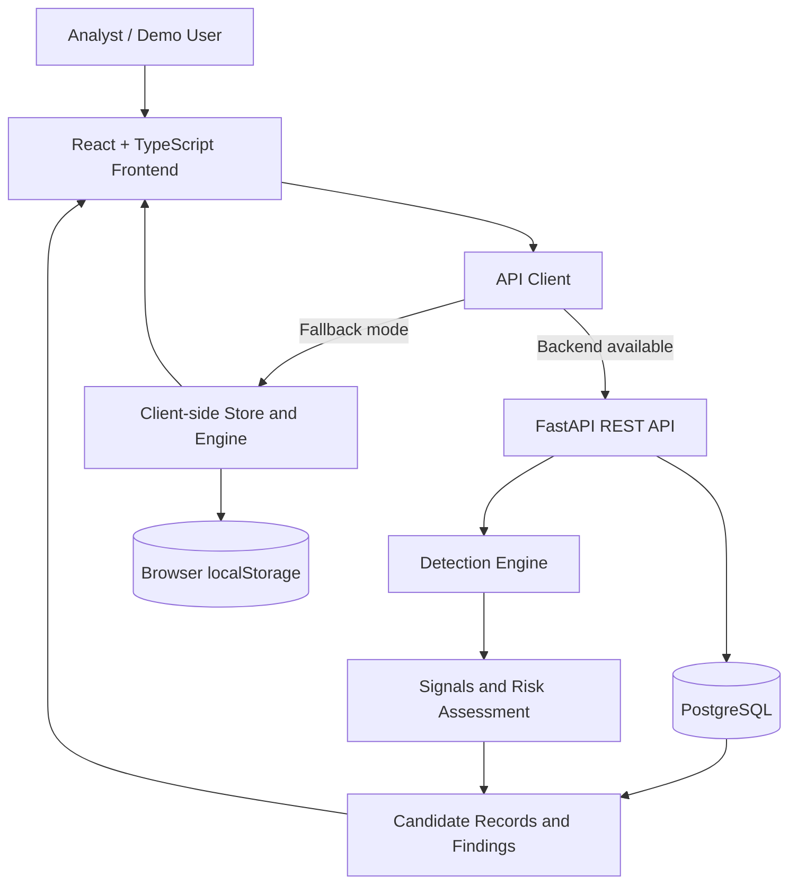

# 🛡️ BrandGuard — Digital Brand Defense & Impersonation Intelligence

> **Enterprise-grade Digital Risk Protection (DRP)** command center for monitoring, detecting, and mitigating brand impersonation, typosquatting, phishing, and counterfeit apps across social networks and mobile app marketplaces.

**Live Demo:** [Open BrandGuard](https://brand-guard1.vercel.app)  
**GitHub Repository:** [Dilshad-shaik-14/BrandGuard1](https://github.com/Dilshad-shaik-14/BrandGuard1)  
**Project Type:** Hackathon prototype and security investigation demonstration

## Product Walkthrough

### Dashboard


- Brand-level security posture, active scan state, and open findings by risk band.
- High/medium/review distribution with latest scan summary.

### Brand Registry


- Register brands, domains, aliases, and official social/app anchors.
- Verify baseline assets before they are used for exclusion/scoring comparisons.

### Findings Explorer


- Filter findings by band/status/type.
- Review score breakdown, evidence panels, and gate outcomes.

### Explainable Detection Evidence


- Character-level diffs (including homoglyph/mixed-script indicators).
- Signal breakdowns for name/logo/bio/identity/scam vectors.
- Candidate-vs-official comparison artifacts.

---


## 🌟 Executive Overview

**BrandGuard** empowers security operations centers (SOCs) and brand protection teams with automated threat intelligence. It systematically monitors official digital assets across major social platforms and mobile app stores, detects malicious look-alikes using algorithmic heuristics, and provides visual forensic comparison tools for swift remediation.

- **Automated Look-alike Detection**: Analyzes character substitutions, leetspeak, homoglyphs, and deceptive affix keywords.
- **Multidimensional Risk Scoring**: Weighted signal analysis across name matching, logo similarity, bio/link redirection, account conflicts, and scam language heuristics.
- **Asset Comparison Studio**: Forensic side-by-side inspection, interactive image wipe slider, and character-level LCS diff with Unicode script annotations.
- **3D Geospatial & Threat Visualizations**: Interactive Three.js Security Globe, Brand Identity Orbital, and Threat Relationship Graph.
- **Auditable Triage & Remediation**: Formal review status workflow (`confirmed`, `false_positive`, `under_review`, `ignored`) with immutable audit trails.

---

## 🏗️ Segregated Architecture

The application is cleanly segregated into dedicated **Frontend** and **Backend** directories for modularity, scalability, and testability.

```
brandguard/
├── backend/                             # Server-side threat intelligence & REST API
│   ├── api/
│   │   └── routes.ts                    # Express REST endpoints
│   ├── engine/
│   │   ├── charDiff.ts                  # Longest Common Subsequence (LCS) character diff & Unicode scripts
│   │   ├── compareFields.ts             # Field normalization & token overlap comparison
│   │   ├── logoAssets.ts                # Brand vector badge & emblem generator
│   │   ├── lookalikeDetector.ts         # Levenshtein distance, homoglyph mapping, affix detection
│   │   └── parseProfile.ts              # Social & App Store URL parser & regex validator
│   ├── services/
│   │   ├── brandguardService.ts         # Core threat intelligence service layer
│   │   └── store.ts                     # Persistence & simulated scan generator
│   ├── types/
│   │   └── brandguard.ts                # TypeScript data models & schema contracts
│   ├── server.ts                        # Express backend server with security headers
│   └── index.ts                         # Backend module exports
│
├── frontend/                            # React 19 Client SPA
│   ├── src/
│   │   ├── components/
│   │   │   ├── evidence/                # Asset comparison studio, ImageWipe, CharDiff, Timeline
│   │   │   ├── risk/                    # Score rulers, risk glyphs, band badges, gate notes
│   │   │   ├── shell/                   # Command palette (⌘K), Notification drawer, Sidebar, TopBar
│   │   │   └── visualization/           # 3D Security Globe (Three.js), Orbital, Threat Graph
│   │   ├── features/
│   │   │   ├── evaluation/              # Precision/Recall performance matrix & calibration
│   │   │   ├── findings/                # Threat findings feed, filters & batch triage
│   │   │   ├── overview/                # Executive dashboard & risk posture summary
│   │   │   ├── profile/                 # Brand profile, baseline assets & lookalike tester
│   │   │   ├── scans/                   # Scan histories, execution progress & scan replay modal
│   │   │   ├── sources/                 # Monitored channels, dataset batches & connectors
│   │   │   └── welcome/                 # Initial brand onboarding wizard
│   │   ├── lib/                         # UI formatters, status labels, SVG generators
│   │   ├── services/                    # Client store & reactive state subscriptions
│   │   ├── types/                       # Frontend TypeScript type declarations
│   │   ├── App.tsx                      # Application routing & layout frame
│   │   ├── index.css                    # Dark cybersecurity theme & Tailwind CSS v4 setup
│   │   └── main.tsx                     # React client DOM mount
│   └── index.ts                         # Frontend exports
│
├── index.html                           # Root HTML shell pointing to /frontend/src/main.tsx
├── server.ts                            # Full-stack Node.js server entry point
├── vite.config.ts                       # Vite 8 config with @frontend & @backend path aliases
├── tsconfig.json                        # Strict TypeScript configuration
└── package.json                         # Dependencies & npm scripts
```

- **Frontend:** React 19, TypeScript, and Vite. The API client calls FastAPI when available and can fall back to client-side storage and detection.
- **Backend:** FastAPI routers, SQLAlchemy models, Pydantic schemas, and Alembic migrations.
- **Persistence:** PostgreSQL 16 for server-side application records.
- **Detection engine:** Deterministic Python modules under `backend/app/engine/`.
- **Evaluation:** Ground-truth labels are stored separately in `evaluation_labels`; the scan logic does not query those labels.



---

## 🔍 Core Detection Capabilities

### 1. Advanced Look-Alike & Typosquatting Engine
- **Homoglyph & Confusable Mapping**: Detects visual character substitutions across Latin, Cyrillic, and Greek alphabets (e.g., Cyrillic `а`, `е`, `о`, `р`, `с`, `у`, `х`).
- **Affix Injection**: Flags deceptive security and promotional suffixes/prefixes (`official`, `support`, `rewards`, `verify`, `help`, `care`).
- **Leetspeak Inversion**: Catches common numeric substitutions (`0` for `o`, `1` for `l`/`i`, `3` for `e`, `5` for `s`, `@` for `a`).
- **Normalized Fuzzy Matching**: Combines character tokenization and Levenshtein metrics to compute match confidence.

### 2. Multi-Signal Composite Risk Scoring
Each finding is evaluated across 5 weighted dimensions:
| Signal Dimension | Weight | Detection Method |
| :--- | :--- | :--- |
| **Name Matching** | `35%` | Homoglyph analysis, edit distance, brand affix matching |
| **Logo Similarity** | `25%` | Vector emblem & palette similarity scoring |
| **Bio & Link Analysis** | `20%` | External domain redirect verification, phishing intent patterns |
| **Account Conflict** | `10%` | Baseline registration ID mismatch vs. verified brand records |
| **Scam Language** | `10%` | High-urgency phrasing, giveaway lures, credential harvesting patterns |

### 3. Risk Bands
- 🔴 **High Risk (`≥ 75`)**: Confirmed deceptive impersonators requiring urgent takedown.
- 🟠 **Medium Risk (`50 – 74`)**: Ambiguous accounts with multiple overlapping threat signals.
- 🟡 **Needs Review (`25 – 49`)**: Partial matches, parody accounts, or unverified secondary channels.
- ⚪ **Ignored (`< 25`)**: Benign mentions, verified partner accounts, or low-similarity candidates.

---

## 🌐 REST API Endpoints

The backend exposes a full suite of threat intelligence REST endpoints:

| Method | Endpoint | Description |
| :--- | :--- | :--- |
| `GET` | `/api/health` | Health status and engine timestamp |
| `GET` | `/api/brands` | List all monitored enterprise brands |
| `GET` | `/api/brands/:brandId` | Retrieve detailed metadata for a single brand |
| `GET` | `/api/brands/:brandId/findings` | Retrieve all detected threat findings for a brand |
| `GET` | `/api/brands/:brandId/assets` | Retrieve registered official baseline assets |
| `GET` | `/api/brands/:brandId/scans` | Retrieve scan execution history & metrics |
| `POST` | `/api/analyze/lookalike` | Analyze candidate username/name for look-alike patterns |
| `POST` | `/api/analyze/parse-profile` | Parse and validate social handle or mobile app ID from URL |
| `POST` | `/api/scans/run` | Trigger a new multi-source reconnaissance scan |
| `POST` | `/api/findings/:id/review` | Update finding status (`confirmed`, `false_positive`, `ignored`) with note |
| `GET` | `/api/sources` | Status of configured monitoring sources & coverage |
| `GET` | `/api/evaluation` | Detection engine precision, recall, and F1 benchmarks |

---

## 🛠️ Technology Stack

- **Frontend**:
  - React 19 (`react`, `react-dom`)
  - React Router DOM v7
  - Tailwind CSS v4 (`@tailwindcss/vite`)
  - Three.js (`three`) for interactive 3D WebGL visualizations
  - Motion (`motion`) for fluid micro-interactions
  - Lucide React icons
- **Backend**:
  - Node.js & Express 4
  - TypeScript (strict mode, ES2022)
  - Detection algorithms (LCS diff, homoglyph mapping, regex tokenizers)
- **Tooling**:
  - Vite 8 (Ultra-fast HMR and production bundle generation)
  - `tsx` for direct TypeScript server execution

---

## 🚀 Getting Started

### Prerequisites
- Node.js `≥ 18.0.0`
- npm or bun

### Installation
```bash
# Clone the repository
git clone <repo-url>
cd brandguard

# Install dependencies
npm install
```

### Running Locally

```bash
# Start the Vite development server (Port 3000)
npm run dev

# Or run the full-stack server with API backend
npm run dev:server
```

Open your browser at `http://localhost:3000`.

### Building for Production
```bash
# Build optimized client bundles
npm run build

# Start production server
npm run preview
```

### Type Checking & Linting
```bash
# Run TypeScript compilation check
npm run lint
```

---

## 🛡️ Security & Concurrency

- **Optimistic Concurrency Control**: Finding reviews utilize version tags (`expectedVersion`) to prevent concurrent analyst overwrites.
- **Mandatory Audit Logging**: State transitions (`new` ➔ `confirmed` / `false_positive`) enforce structured analyst notes and reviewer attribution.
- **Content Security Headers**: Pre-configured `X-Content-Type-Options: nosniff` and `X-Frame-Options: SAMEORIGIN` headers on all backend routes.

---

## 📄 License

Proprietary — Internal Security Operations & Brand Defense Use.
