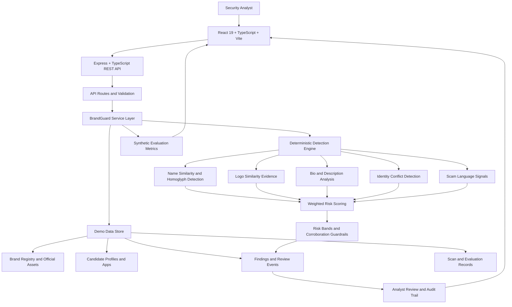

# BrandGuard - Digital Identity Protection Platform

> **Live demo:** https://brand-guard1.vercel.app

BrandGuard is a deterministic, explainable triage platform for suspicious brand social profiles and mobile apps. It compares candidate identities against registered official assets, produces transparent risk evidence, and supports analyst review decisions.

**Scope clarification:** this repository is a **local demonstration/evaluation system**. It scans candidate records that already exist in the app data store, is **not** a continuous internet crawler, and does **not** submit automatic takedown requests.

## Product Walkthrough

### Dashboard


- Brand-level security posture, active scan state, and open findings by risk band.
- High/medium/review distribution with latest scan summary.

### Brand Registry


- Register brands, domains, aliases, and official social/app anchors.
- Verify baseline assets before they are used for exclusion/scoring comparisons.

### Findings Explorer


- Filter findings by band/status/type.
- Review score breakdown, evidence panels, and gate outcomes.

### Explainable Detection Evidence


- Character-level diffs (including homoglyph/mixed-script indicators).
- Signal breakdowns for name/logo/bio/identity/scam vectors.
- Candidate-vs-official comparison artifacts.


## Contents

- [Problem](#problem)
- [Solution and workflow](#solution-and-workflow)
- [Feature status](#feature-status)
- [Product walkthrough](#product-walkthrough)
- [Architecture](#architecture)
- [Technology stack](#technology-stack)
- [Detection methodology](#detection-methodology)
- [Synthetic examples](#synthetic-examples)
- [Risk scoring and finding lifecycle](#risk-scoring-and-finding-lifecycle)
- [API reference](#api-reference)
- [Evaluation and testing](#evaluation-and-testing)
- [Local setup](#local-setup)
- [Data sources and integration boundaries](#data-sources-and-integration-boundaries)
- [Repository structure](#repository-structure)
- [Security and responsible use](#security-and-responsible-use)
- [Deployment instructions](#deployment-instructions)
- [Limitations and future improvements](#limitations-and-future-improvements)
- [Conclusion](#conclusion)

## Problem

Brand abuse detection needs to catch:
- typo/homoglyph impersonation,
- copied or near-copied logos/icons,
- official-sounding language in bios/descriptions,
- identity/package conflicts (account IDs, handles, package IDs, developer IDs),
- while limiting false positives from legitimate third parties.

This project uses **synthetic demonstration data**. Any mention of **NovaPay** in this README refers to fictional benchmark examples only.

## Solution and workflow

Target workflow (requested architecture) and current implementation are reconciled below:

1. Register brands and official anchors (social handles, package/bundle IDs, developer identity).
2. Load an isolated synthetic benchmark (e.g., fictional NovaPay-like samples).
3. Run a scan over database-resident candidate records.
4. Exclude candidates that exactly match official IDs/package IDs before scoring.
5. Compute deterministic signals: name, logo, description/bio, identity conflict, scam language.
6. Apply normalized weights and corroboration guardrails (name-only/coverage caps).
7. Persist findings and review decisions.
8. Analysts review findings and produce human-reviewed takedown drafts.

### Current repository truth
- The codebase is **TypeScript + Express + React**, not FastAPI.
- Persistence in this repo is demo-state storage (front-end local state/localStorage), not PostgreSQL.
- Human-reviewed workflows are implemented; automatic takedown submission is not.

## Feature status

| Capability | Status in current repo | Notes |
|---|---|---|
| Brand registration and official asset baseline | Implemented | UI and store support brand/asset management. |
| Deterministic multi-signal scoring | Implemented | Weighted signal breakdown shown per finding. |
| Explainable evidence views | Implemented | Char diff, comparison tables, signal evidence views exist. |
| Findings review lifecycle and audit events | Implemented | Review statuses and event trail are stored per finding. |
| Synthetic benchmark/evaluation dashboards | Implemented | Evaluation metrics are seeded synthetic data. |
| Continuous live crawling scheduler | Not implemented | Current scans are local demo operations over resident candidate data. |
| Automatic takedown request submission | Not implemented | Next-step guidance is generated, but submission is manual/out of scope. |
| Authentication/tenant isolation | Not implemented | Demo app; no auth service in this checkout. |
| FastAPI + PostgreSQL + Alembic stack | Planned / not present in this checkout | Current backend is Express + TypeScript with in-repo state model. |

## Architecture

### Implemented in this repository
- **Frontend:** React 19 + TypeScript + Vite.
- **Backend:** Express + TypeScript API.
- **Engine:** deterministic TypeScript scoring/parsing/diff utilities.
- **Data model:** seeded synthetic brands/findings/scans/evaluation with local persistence for demo use.
- **Evaluation:** isolated synthetic labels and metrics in app state.

### Requested/alternative architecture (not currently present in repo)
The user-supplied target mentions FastAPI + SQLAlchemy/Pydantic/Alembic + PostgreSQL 16 via Docker Compose. Those services/files are not present in this checkout.

### Explicitly absent from current implementation
No workers/queues/crawlers/schedulers/auth service/automatic takedown service are implemented in this repository.
## Architecture

BrandGuard follows a modular, analyst-centric architecture that separates the user interface, API layer, detection engine, data management, and evaluation workflows. The platform processes candidate social profiles and mobile app records against registered official brand assets to generate explainable risk findings.

### Architecture Diagram



### 1. Presentation Layer

**Technologies:** React 19, TypeScript, Vite, Tailwind CSS.

The frontend provides an interactive security analyst workspace through:

- **Dashboard:** Brand security posture, scan summaries, and risk distribution.
- **Brand Registry:** Registration of brands, aliases, domains, and official identity assets.
- **Findings Explorer:** Filtering, prioritization, and investigation of suspicious candidates.
- **Evidence Viewer:** Character-level differences, signal breakdowns, and identity comparisons.
- **Review Workflow:** Updating finding statuses and recording analyst decisions.

### 2. API Layer

**Technologies:** Node.js, Express, TypeScript.

The Express backend exposes REST endpoints under `/api` for brand management, scanning, lookalike analysis, profile parsing, finding reviews, and evaluation data.

The API layer connects frontend requests to the service and detection modules. It is separate from the React presentation layer, allowing backend logic to evolve independently.

### 3. Detection and Risk Analysis Engine

**Technology:** TypeScript.

The detection engine evaluates candidate identities against registered official assets using deterministic, explainable signals:

- **Name similarity:** Typographical variations, homoglyphs, mixed scripts, and lookalike patterns.
- **Logo similarity:** Visual similarity evidence associated with candidate and official assets.
- **Description analysis:** Similarity in profile biographies, descriptions, and suspicious language.
- **Identity conflicts:** Mismatches involving handles, account identifiers, package IDs, and developer identities.
- **Scam indicators:** Suspicious language and other risk-related evidence.

The engine combines the available signals using weighted scoring and applies guardrails, including name-only and low-evidence-coverage caps. Findings are assigned risk bands to help analysts prioritize investigations.

### 4. Data Management Layer

**Current implementation:** Demo-state storage with frontend local state and localStorage.

The application manages demonstration records for:

- Registered brands and official assets.
- Candidate social profiles and mobile applications.
- Scan records and generated findings.
- Analyst review decisions and event history.
- Synthetic evaluation datasets and metrics.

The current repository does **not** implement PostgreSQL persistence or a production database migration layer. Data persistence depends on the specific application flow and storage mechanism.

### 5. Review and Audit Layer

The review workflow supports human-controlled decisions, including `new`, `under_review`, `confirmed`, `false_positive`, and `resolved` statuses.

Review actions maintain event history containing status transitions, reviewer information, notes, and timestamps where supported by the implementation. This helps analysts understand how findings were handled.

BrandGuard provides investigation support and takedown guidance; it does not automatically submit takedown requests.

### 6. Evaluation Layer

The evaluation interface presents seeded synthetic metrics and benchmark examples to demonstrate the detection workflow and compare risk-scoring behavior.

These metrics are intended for demonstration and algorithm evaluation. They should not be interpreted as independently validated production detection accuracy.

### 7. Deployment and Integration Boundaries

The frontend can be built and deployed as a web application, while the Express backend can run as a separate Node.js service when the deployment environment supports it.

The current repository does not include a production crawler, scheduled scanning workers, a queue system, authentication service, tenant isolation, or a PostgreSQL-backed infrastructure.

### Architecture Summary

| Component | Technology | Responsibility |
|---|---|---|
| Frontend | React 19, TypeScript, Vite | Analyst dashboard and investigation UI |
| API | Express, TypeScript | REST endpoints and request handling |
| Detection engine | TypeScript modules | Similarity analysis and explainable scoring |
| Demo data layer | App state and localStorage | Demonstration records and review state |
| Evaluation | Synthetic benchmark data | Demonstration metrics and scoring comparisons |
| Deployment | Vercel frontend; separately hosted backend where configured | Application delivery |

**Design principle:** BrandGuard prioritizes explainability, deterministic scoring, human oversight, and a clear separation between implemented demo capabilities and planned production infrastructure.

## Technology stack

| Layer | Verified technology | Usage in this repository |
|---|---|---|
| Frontend | React 19, TypeScript, Vite | Analyst UI and dashboards |
| Backend API | Express, TypeScript | REST endpoints under `/api` |
| Detection engine | TypeScript modules | Name parsing, lookalike heuristics, char diff, field comparisons |
| Styling/UI | Tailwind (via `@tailwindcss/vite`) | Frontend styling |
| Runtime | Node.js | App/runtime scripts |
| AI dependency | `@google/genai` | Present in dependencies (feature usage depends on app flows) |
| Persistence (demo) | Local app state/localStorage | Synthetic data and review event state |
| Container DB stack | Docker Compose + PostgreSQL 16 | Not present in current checkout |

## Detection methodology

### 1) Name similarity (NFKC/homoglyph/leetspeak-oriented checks)
- Lookalike detector handles spacing/punctuation variants, confusable non-ASCII characters, mixed scripts, leetspeak substitutions, transpositions, insertions/deletions, and added-word affixes.
- Character-level diff utilities expose script/homoglyph context to analysts.

### 2) Logo similarity
- Findings include logo/icon similarity evidence and contributions.
- UI/evidence references perceptual-style comparisons for analyst inspection.

### 3) Description/Bio similarity
- Bio/description similarity contributes as a weighted text signal.
- Suspicious language and off-domain links influence risk.

### 4) Identity conflicts
- Candidate-vs-official account identity mismatches (e.g., external ID, handle/package/developer mismatch) are scored.
- Exact official identifiers are set aside before scoring to reduce self-alerts.

### 5) Official asset exclusion
- Official baselines are excluded prior to risk ranking when exact identifiers match.

### 6) Risk scoring (base weights and bands)
**Base signal weights used in seeded findings:**
- Name similarity: **0.35**
- Logo similarity: **0.25**
- Bio/description similarity: **0.20**
- Identity conflict: **0.10**
- Scam language: **0.10**

**Bands used by the UI/workflow:**
- `ignored`: < 30
- `needs_review`: 30–54
- `medium`: 55–74
- `high`: 75–100

**Guardrails:**
- Name-only cap (prevents promotion without corroborating signals).
- Low-coverage cap (evidence coverage gating before high-certainty escalation).

## Synthetic examples

The repository ships seeded synthetic brands (e.g., Veltrix, Marigold, Orbyte). For the requested NovaPay framing, these fictional examples illustrate expected behavior:

| Synthetic NovaPay example | Expected behavior |
|---|---|
| `N0vaPay Support` with leetspeak and scam refund language | High/medium candidate depending on corroborating logo/bio/ID conflict signals |
| `NоvaPay` (Cyrillic homoglyph) using copied icon | High-risk due to homoglyph + visual similarity + identity conflict |
| `NovaPay Delivery Hiring` third-party staffing post | Needs review (possible legitimate partner; analyst verification required) |
| App package `com.novapay.wallet.pro` by unrelated publisher | Medium/high candidate with package/developer conflict indicators |
| Official NovaPay handle/package exact match | Excluded before scoring (no impersonation finding) |

## Risk scoring and finding lifecycle

- Review statuses: `new` → `under_review` → `confirmed` / `false_positive` / `resolved`.
- Review actions append immutable event entries (`from_status`, `to_status`, reviewer, note, timestamp).
- Bulk actions can re-prioritize bands while preserving review-event history.
- Analyst output is human-reviewed triage/takedown guidance; Markdown-style reporting can be generated from reviewed findings externally.

## API reference

Current backend is Express. Endpoints below are implemented under `/api`:

| Method | Path | Purpose |
|---|---|---|
| GET | `/api/health` | API health response |
| GET | `/api/brands` | List brands |
| GET | `/api/brands/:brandId` | Fetch single brand |
| GET | `/api/brands/:brandId/findings` | List findings for brand |
| GET | `/api/brands/:brandId/assets` | List official assets for brand |
| GET | `/api/brands/:brandId/scans` | List scans for brand |
| POST | `/api/analyze/lookalike` | Deterministic name-lookalike analysis |
| POST | `/api/analyze/parse-profile` | Parse social/app profile input |
| POST | `/api/findings/:id/review` | Update finding review status |
| POST | `/api/scans/run` | Trigger scan run |
| GET | `/api/sources` | List source metadata |
| GET | `/api/evaluation` | Return synthetic evaluation metrics |
| GET | `/api-status` | Backend service status |

### OpenAPI / Swagger / ReDoc
- FastAPI-style `/openapi.json`, `/docs`, `/redoc` are **not configured** in this checkout.

### Local API commands
```bash
# start backend
npx tsx /home/runner/work/BrandGuard1/BrandGuard1/backend/server.ts

# health
curl http://localhost:3000/api/health

# status
curl http://localhost:3000/api-status

# list brands
curl http://localhost:3000/api/brands
```

## Evaluation and testing

### Backend/frontend checks available in repository
- `npm run lint` (TypeScript type-check)
- `npm run build` (Vite production build)

### Tests
- No dedicated unit/integration test suite is currently configured in this checkout.

### Dependency caveats
- Some features depend on environment/config values (see `.env.example`).
- `@google/genai` exists in dependencies; behavior depends on runtime flows and key configuration.

### Synthetic evaluation metrics
- Evaluation views and numbers are seeded synthetic metrics intended for demonstration and algorithm comparison, not production KPI claims.

## Local setup

### Prerequisites
- Node.js 18+
- npm (or bun)

### 1) Frontend-only / client fallback setup
```bash
cd /home/runner/work/BrandGuard1/BrandGuard1
npm install
npm run dev
```
Open `http://localhost:3000`.

### 2) Docker Compose backend setup
- **Not available in this checkout** (`docker-compose*.yml` is absent).
- If you require containerized backend+database, add Compose assets in a future infrastructure update.

### 3) Backend without Docker
```bash
cd /home/runner/work/BrandGuard1/BrandGuard1
npm install
npx tsx backend/server.ts
```

### 4) Demo sequence
1. Launch app and select a seeded brand.
2. Review registered official assets in profile/registry flows.
3. Trigger a scan and inspect findings.
4. Open evidence panels and signal breakdowns.
5. Apply analyst review decisions with notes.

## Data sources and integration boundaries

- Current dataset is synthetic/demo-first, with imported-batch placeholders (`simulated` and `imported` origins).
- CSV/JSON-style ingestion behavior is represented by import workflows in app state.
- Apple iTunes catalog/App Store source metadata is present as seeded source descriptors.
- **Important:** catalog/source entries in this demo do **not** prove live production integrations in this repository.

## Repository structure

```text
/home/runner/work/BrandGuard1/BrandGuard1
├── backend/
│   ├── api/routes.ts
│   ├── engine/
│   │   ├── charDiff.ts
│   │   ├── compareFields.ts
│   │   ├── logoAssets.ts
│   │   ├── lookalikeDetector.ts
│   │   └── parseProfile.ts
│   ├── services/
│   │   ├── brandguardService.ts
│   │   └── store.ts
│   ├── types/brandguard.ts
│   ├── index.ts
│   └── server.ts
├── frontend/
│   ├── index.ts
│   └── src/
│       ├── components/
│       ├── features/
│       ├── lib/
│       ├── services/
│       ├── types/
│       ├── App.tsx
│       ├── index.css
│       └── main.tsx
├── index.html
├── metadata.json
├── package.json
├── server.ts
├── tsconfig.json
└── vite.config.ts
```

## Security and responsible use

- Use this project for defensive brand-protection evaluation and analyst training.
- Do not treat synthetic outputs as legal conclusions without human verification.
- Keep API keys/secrets out of source control.
- Do not automate abusive scanning/takedown actions from this demo codebase.

## Deployment instructions

- **Live demo:** https://brand-guard1.vercel.app
- For local production-like frontend build:
```bash
cd /home/runner/work/BrandGuard1/BrandGuard1
npm install
npm run build
npm run preview
```
- Backend service can be started separately via `npx tsx backend/server.ts`.

## Limitations and future improvements

1. Add real persistence (e.g., PostgreSQL) and migration tooling.
2. Add authenticated multi-tenant analyst workflows.
3. Add formal OpenAPI docs and generated SDK clients.
4. Add repeatable backend and frontend test suites.
5. Add ingestion connectors with explicit consent/compliance controls.
6. Add structured takedown draft export pipelines.

## Conclusion

BrandGuard provides an explainable, deterministic foundation for impersonation triage across social and app channels. This repository currently demonstrates the workflow with synthetic data and analyst-first review controls, while clearly separating implemented features from planned production architecture.
